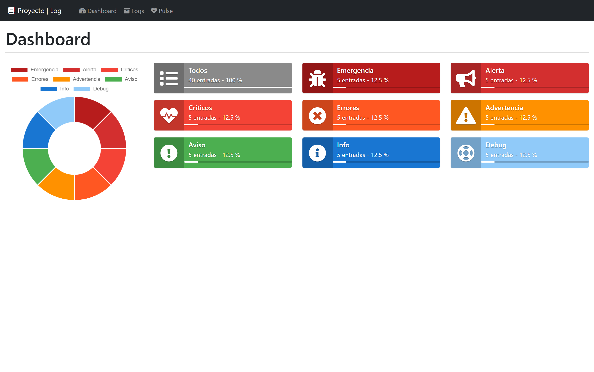
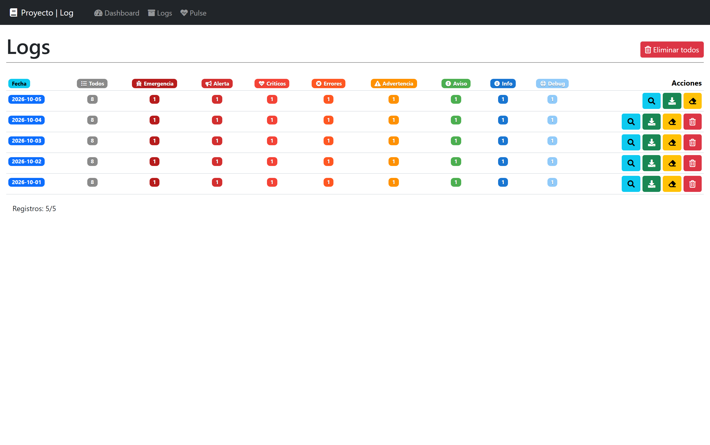
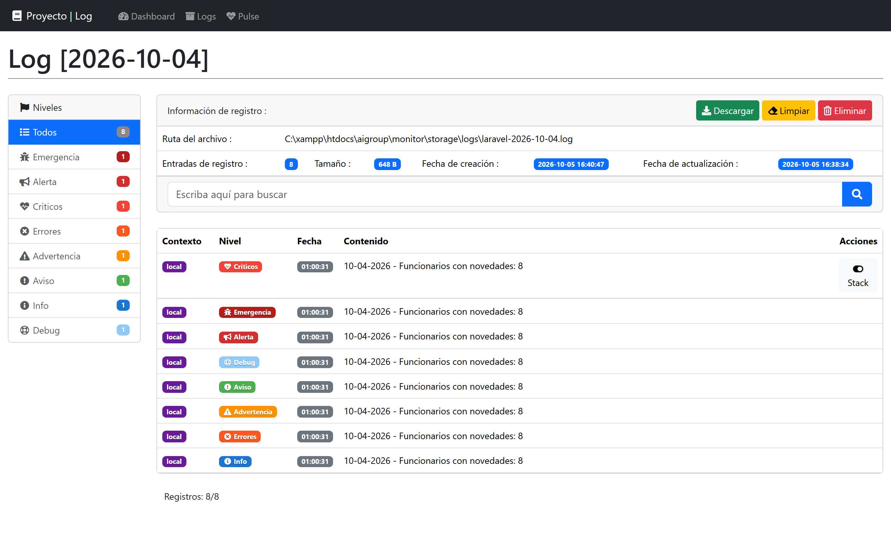

# LogViewer [![Packagist License][badge_license]](LICENSE.md) [![For Laravel][badge_laravel]][link-github-repo]

[![Github Workflow Status][badge_build]][link-github-status]
[![Github Issues][badge_issues]][link-github-issues]

[![Packagist][badge_package]][link-packagist]
[![Packagist Release][badge_release]][link-packagist]
[![Packagist Downloads][badge_downloads]][link-packagist]

*Fork of [ARCANEDEV/LogViewer](https://github.com/ARCANEDEV/LogViewer), maintained by [buriti8](https://github.com/buriti8).*

This package allows you to manage and keep track of each one of your log files.

 > **NOTE: You can also use LogViewer as an API.**

Official documentation for LogViewer can be found at the [_docs folder](_docs/1.Installation-and-Setup.md).

Feel free to check out the [releases](https://github.com/buriti8/LogViewer/releases), [license](LICENSE.md), and [contribution guidelines](CONTRIBUTING.md).

## Features

  - A great Log viewer API.
  - Laravel `5.x` to `12.x` are supported.
  - Ready to use (Views, Routes, controllers &hellip; Out of the box) [Note: No need to publish views, compile or copy assets: the compiled CSS, JS and fonts ship with the package]
  - View, paginate, filter, download, clear and delete logs.
  - Delete every listed log in one click (keeps today's active log); extra logs are opt-in via a checkbox.
  - Also list extra, non date-based log files (`worker.log`, `horizon.log`, etc.), optionally.
  - Mobile-friendly log detail view (entries stack into readable cards instead of squeezing/wrapping).
  - Load a custom logs storage path.
  - Localized log levels.
  - Logs menu/tree generator.
  - Grouped logs by dates and levels.
  - Customized log levels icons (font awesome by default).
  - Works great with big logs !!
  - Well documented package (IDE Friendly).
  - Well tested (100% code coverage with maximum code quality).

## Table of contents

  1. [Installation and Setup](_docs/1.Installation-and-Setup.md)
  2. [Configuration](_docs/2.Configuration.md)
  3. [Usage](_docs/3.Usage.md)

### Supported localizations

 > Dear artisans, i'm counting on you to help me out to add more translations ( ^_^)b

| Local   | Language              |
|---------|-----------------------|
| `ar`    | Arabic                |
| `bg`    | Bulgarian             |
| `bn`    | Bengali               |
| `de`    | German                |
| `en`    | English               |
| `es`    | Spanish               |
| `et`    | Estonian              |
| `fa`    | Farsi                 |
| `fr`    | French                |
| `he`    | Hebrew                |
| `hu`    | Hungarian             |
| `hy`    | Armenian              |
| `id`    | Indonesian            |
| `it`    | Italian               |
| `ja`    | Japanese              |
| `ko`    | Korean                |
| `ms`    | Malay                 |
| `nl`    | Dutch                 |
| `pl`    | Polish                |
| `pt-BR` | Brazilian Portuguese  |
| `ro`    | Romanian              |
| `ru`    | Russian               |
| `si`    | Sinhalese             |
| `sv`    | Swedish               |
| `th`    | Thai                  |
| `tr`    | Turkish               |
| `uk`    | Ukrainian             |
| `uz`    | Uzbek                 |
| `zh`    | Chinese (Simplified)  |
| `zh-TW` | Chinese (Traditional) |

## Differences from the original package

This fork keeps the original API, namespace (`Arcanedev\LogViewer`) and configuration, so it works as a drop-in replacement. On top of that:

  - **Assets included:** the compiled CSS, JS (Bootstrap 5, Chart.js) and Font Awesome fonts live in `dist/` and are served by the package itself (route `log-viewer::assets`). Nothing to publish, compile or copy in your project.
  - **Clear a log:** empty the contents of a log file without deleting it (route `log-viewer::logs.clear`). The "Delete" button is hidden for today's log.
  - **Delete all listed logs:** a button on the Logs page deletes every log currently listed, in one click (route `log-viewer::logs.delete-all`). See [Usage](_docs/3.Usage.md).
  - **Extra (non date-based) log files:** optionally list files like `worker.log` or `horizon.log` alongside the dated ones, with the same view/download/clear/delete actions. See [Configuration](_docs/2.Configuration.md#listing-extra-non-date-based-log-files).
  - **Pulse link:** the navbar shows a link to Laravel Pulse when the `pulse` route exists.
  - **Bootstrap 5 views** refreshed, with Spanish translations (`es`).

## Development (only for contributors)

> **You do NOT need Node or `npm` to use this package.** `composer require buriti8/log-viewer` already includes the compiled assets. This section is only for people who want to modify the package itself.

To change the package styles or scripts, edit `resources/js` / `resources/sass` and rebuild `dist/` with [Laravel Mix](https://laravel-mix.com/):

```bash
npm install
npm run watch   # while working
npm run prod    # before committing
```

## Releasing a new version (for the maintainer)

This package is published on [Packagist][link-packagist] and consumed by other projects (e.g. via `composer require buriti8/log-viewer`). Packagist **does not** read your code directly: it reads your **GitHub repository**, and it only updates a new tag or `dev-master` once GitHub tells it to (via a webhook) or once a week otherwise. So, for every change:

1. **Commit your change** on a branch and open a Pull Request against `master` (or commit straight to `master` for small fixes).
2. **Merge to `master`.** Packagist's GitHub webhook fires automatically on every push once it's configured (see below), and `dev-master` on Packagist updates within seconds.
3. **Tag a release** when the change is meaningful enough for consumer projects to pick it up as a stable version (bugfix, new feature, etc.):

   ```bash
   git tag v12.0.1       # bump following semver: vMAJOR.MINOR.PATCH
   git push origin v12.0.1
   ```

   Packagist picks up the new tag the same way (webhook), and projects that require e.g. `"buriti8/log-viewer": "^12.0"` can now `composer update buriti8/log-viewer` to get it.
4. In the consumer project (e.g. `enruta_epm`), run:

   ```bash
   composer84 update buriti8/log-viewer
   ```

   to pull the new version, then test the change there.

**When to bump which version number (`vMAJOR.MINOR.PATCH`):**

  - **PATCH** (`v12.0.1` → `v12.0.2`): bug fixes, no new public behavior.
  - **MINOR** (`v12.0.x` → `v12.1.0`): new features/config options that don't break existing usage (e.g. the "Delete all" button, the `pattern.extra` option).
  - **MAJOR** (`v12.x.x` → `v13.0.0`): breaking changes (renamed routes/config keys, dropped PHP/Laravel support, etc.).

### Keeping Packagist in sync automatically (GitHub Hook)

If `https://packagist.org/packages/buriti8/log-viewer` shows *"This package is not auto-updated"*, Packagist isn't being notified on push and will only re-crawl the repository about once a week. To fix it permanently:

  - **Recommended:** on [your Packagist profile settings](https://packagist.org/profile/edit), under **"GitHub account"**, click **"Connect accounts"** and authorize Packagist via GitHub OAuth. Packagist will then configure the push webhook on `buriti8/LogViewer` (and any other `buriti8/*` repo) by itself — nothing to copy/paste.
  - **Manual alternative:** in the GitHub repository → **Settings → Webhooks → Add webhook**, with:
    - Payload URL: `https://packagist.org/api/github?username=buriti8`
    - Content type: `application/json`
    - Secret: your Packagist **API Token** (find it on your [profile page](https://packagist.org/profile/))
    - Events: just the `push` event

Once set up, every `git push` (to any branch/tag) updates Packagist almost instantly — you won't need to trigger a manual update or wait for the weekly crawl.

## Developing locally against this package (without publishing first)

While you iterate on a change, you can make a consumer project (e.g. `enruta_epm`) use your local working copy instead of the version on GitHub/Packagist, with a Composer [`path` repository](https://getcomposer.org/doc/05-repositories.md#path):

```json
{
    "repositories": [
        {
            "type": "path",
            "url": "../../packages/Laravel/LogViewer",
            "options": { "symlink": true }
        }
    ],
    "require": {
        "buriti8/log-viewer": "dev-master"
    },
    "minimum-stability": "dev"
}
```

Then run `composer84 update buriti8/log-viewer --with-all-dependencies`. Composer will symlink (junction, on Windows) the package instead of downloading it, so every change you save here is reflected immediately in the consumer app — no reinstall needed. Remember to revert these `composer.json`/`minimum-stability` changes (and run `composer84 install` again) once you're done testing, so the project goes back to consuming the published version.

## Acknowledgements

Thanks to [ARCANEDEV](https://github.com/ARCANEDEV) for creating [LogViewer](https://github.com/ARCANEDEV/LogViewer) and releasing it under the MIT license. Almost all of the code of this package is their work; this fork only adds the improvements listed above.

## Contribution

Any ideas are welcome. Feel free to submit any issues or pull requests, please check the [contribution guidelines](CONTRIBUTING.md).

## Security

If you discover any security related issues, please report them privately through the [security advisories](https://github.com/buriti8/LogViewer/security/advisories/new) of the repository instead of using the public issue tracker.

## Credits

- [ARCANEDEV][link-author] — author of the [original package](https://github.com/ARCANEDEV/LogViewer) this project is forked from
- [buriti8][link-maintainer] — maintainer of this fork
- [All Contributors][link-contributors]

## PREVIEW





[badge_laravel]:      https://img.shields.io/badge/Laravel-5.x%20to%2012.x-orange.svg?style=flat-square
[badge_license]:      https://img.shields.io/packagist/l/buriti8/log-viewer.svg?style=flat-square
[badge_build]:        https://img.shields.io/github/workflow/status/buriti8/LogViewer/run-tests?style=flat-square
[badge_issues]:       https://img.shields.io/github/issues/buriti8/LogViewer.svg?style=flat-square
[badge_package]:      https://img.shields.io/badge/package-buriti8/log--viewer-blue.svg?style=flat-square
[badge_release]:      https://img.shields.io/packagist/v/buriti8/log-viewer.svg?style=flat-square
[badge_downloads]:    https://img.shields.io/packagist/dt/buriti8/log-viewer.svg?style=flat-square

[link-author]:        https://github.com/arcanedev-maroc
[link-maintainer]:     https://github.com/buriti8
[link-github-status]: https://github.com/buriti8/LogViewer/actions
[link-github-repo]:   https://github.com/buriti8/LogViewer
[link-github-issues]: https://github.com/buriti8/LogViewer/issues
[link-contributors]:  https://github.com/buriti8/LogViewer/graphs/contributors
[link-packagist]:     https://packagist.org/packages/buriti8/log-viewer
